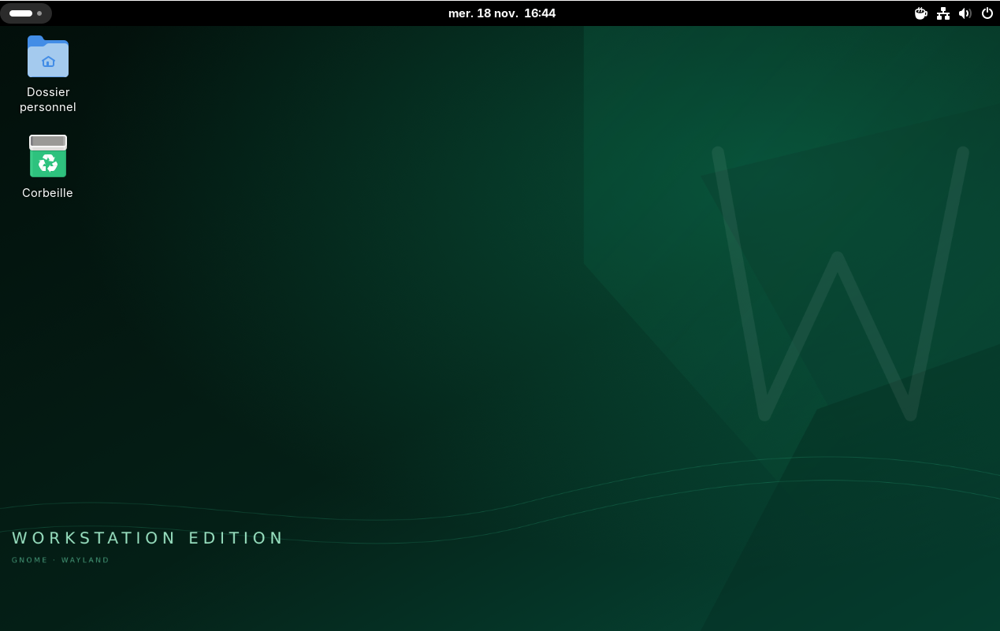
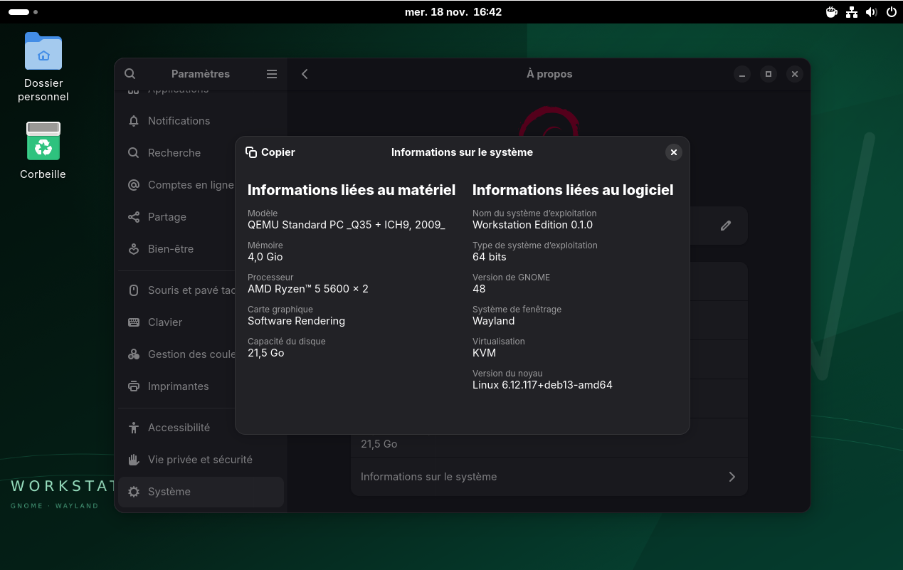
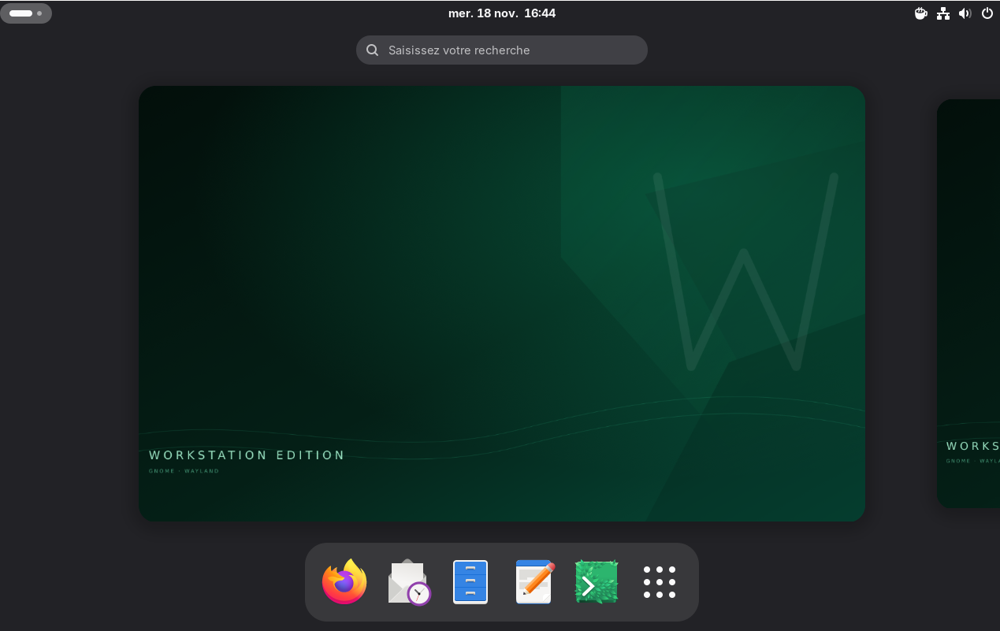

# Workstation Edition

[](https://github.com/benmoussa-younes/workstation/releases/tag/v0.3.0)
[](LICENSE)
[](https://github.com/benmoussa-younes/workstation/actions/workflows/ci.yml)

Ansible roles that turn a **Debian amd64** machine into a GNOME desktop on
Wayland — the session, the link, the identity, the boot splash and the declared
applications — shipped as the collection `benmoussa.workstation`.



`Workstation Edition` is the desktop counterpart of the Server collection,
`benmoussa.server`. The product owns the desktop machine; it does **not** create
the human account: the installer or the site creates it, and the product adds
its desktop groups and its locale. GNOME on Wayland is the only desktop it
ships.

## What it does

- **A GNOME desktop on Wayland**, from Debian's own packages: the shell, GDM,
  PipeWire, the fonts and the declared applications. One desktop, no edition to
  choose.
- **One owner for the link**: NetworkManager carries the wired or Wi-Fi link,
  with a static address you declare, a resolver that always has an upstream, and
  a Wi-Fi key stored derived from the passphrase — never in clear.
- **An identity and a boot experience**: the product's name in os-release and on
  the login banner, the emerald wallpaper, GDM's logo, the GRUB menu and a
  Plymouth theme that also asks for the LUKS passphrase.
- **A declared application set**: Firefox from Mozilla, LibreOffice, Evolution,
  GIMP, Inkscape, Secrets, Ptyxis and VLC as the default media handler — plus
  six folders in the application grid.
- **Developer tools on demand**: the `scripts` interpreter from its public
  release, the .NET 10 SDK, VSCodium and the rest through `developer_tools`;
  OpenCode when `coding_agents_opencode_enabled` is set, pinned by version and
  checksum.
- **A security baseline**: nftables input default-deny with SSH restricted to
  your sources, a hardened sshd and SSH client, a password policy, kernel and audit
  hardening — and Avahi retired rather than half-configured.
- **Provable by construction**: every role reads its own change back, a second
  converge must print `changed=0`, and a declared address is proved by the boot
  that uses it.

## Screenshots

| The application grid | The system panel |
|---|---|
|  |  |
| **The workspace switcher** | **A GNOME desktop, not a skin** |
|  |  |

## Requirements

- a target running **Debian amd64**; the supported release is named in the
  identity distribution table, and an unknown release is refused;
- `ansible-core` **2.19 or later** on the controller, with SSH access to the
  target;
- an existing human account, named by `workstation_user`;
- a privilege-escalation password: no account of the product holds `NOPASSWD`;
- the target's host key in the controller's `known_hosts`;
- network access to `packages.mozilla.org` and, when `developer_tools` selects
  `dotnet`, `packages.microsoft.com`; `download.vscodium.com` only when it
  selects `vscodium`; `github.com` and `api.github.com` when it selects
  `scripts` and when `coding_agents_opencode_enabled` is true; `opencode.ai`
  only for that opt-in installer.

Only `ansible.builtin` is used. `requirements.yml` declares no external
collection.

## Install the collection

From the release tarball:

```sh
ansible-galaxy collection install benmoussa-workstation-0.3.0.tar.gz -p ./collections
```

The release also carries `workstation-0.3.0-src.tar.gz` (the source tree with the
example inventory and the repository tooling) and `SHA256SUMS`:

```sh
sha256sum -c SHA256SUMS
```

The collection carries the roles, the playbooks, `meta/`, `assets/` and the
licence texts. It does not carry an inventory: the site owns its inventory and
its vault. The source archive carries `inventories/example/`, which documents
the site-facing variables with TEST-NET-1 values only.

## Use it

Create the site inventory from the source archive's `inventories/example/`, or
write a minimal one:

```yaml
all:
  hosts:
    workstation:
      ansible_host: 192.0.2.10
      ansible_user: operator
      ansible_connection: ssh
      workstation_user: operator
  vars:
    identity_product: workstation-gnome
    workstation_desktop_groups: [audio, video, render, input, netdev, bluetooth, cdrom, plugdev, systemd-journal]
    workstation_locale: fr_FR.UTF-8
    workstation_locale_language: fr_FR:fr
    developer_tools: [build, debug, clang, dotnet, lint, ansible, python, shell]
    gaming_enabled: false
    keyboard_layout: fr
    time_timezone: Etc/UTC
    security_ssh_sources: [192.0.2.0/24]
```

A site playbook imports the collection:

```yaml
- import_playbook: benmoussa.workstation.site
```

Or address the collection playbook directly:

```sh
ansible-playbook -i inventories/acme/hosts.yml benmoussa.workstation.site \
  --check --diff --ask-become-pass
ansible-playbook -i inventories/acme/hosts.yml benmoussa.workstation.site \
  --ask-become-pass
ansible-playbook -i inventories/acme/hosts.yml benmoussa.workstation.site \
  --ask-become-pass                         # must print changed=0
```

The first converge restarts GDM; run it over SSH, never from the session it may
restart, and keep the console within reach. A change that touches GDM, GRUB or
Plymouth is not proved by `--check`: the visual proof is a console check.

## The roles

| Role | Concern |
|---|---|
| `common` | The Debian package baseline, periodic security upgrades, the shared directories and the server's Bluetooth mask withdrawn. Shotwell is retired (Loupe is the image viewer) and Avahi is retired too: the unit, its alias and its D-Bus activation file are all closed. |
| `identity` | The product name on os-release, issue, issue.net and the login banner. |
| `journald` | The journal's size and retention. |
| `keyboard` | The console keyboard and GRUB's copy. |
| `hardening` | The kernel and system policy, `graphical.target`, `splash` and the reboot policy. |
| `performance` | The declared VM, I/O and TCP tuning, THP, the CPU governor and the D-Bus provider (`dbus-broker` by default, `dbus-daemon` as the rollback). |
| `network` | NetworkManager owns the link; a Wi-Fi site that handed it over itself is verified, not overwritten. The Wi-Fi key is stored derived from the passphrase, never in clear. |
| `resolver` | The stub resolver, fed by the link or by a declared filtering resolver. |
| `time` | Exactly one time daemon and the declared zone. |
| `gnome` | Debian's `gnome-core` and desktop task, and a Wayland session. |
| `desktop` | The account's desktop groups, locale and Bluetooth daemon. |
| `dconf` | The profile-wide GNOME policy: appearance, wallpaper, screen lock, privacy, extensions, favorites and the six application-grid folders. |
| `applications` | The declared Debian applications (including VLC, default for video/audio MIME), GNOME Shell extensions, GNOME Secrets and Mozilla Firefox. |
| `developer` | The declared developer tool groups through `developer_tools`, Debian packages, the .NET 10 SDK from Microsoft's pinned repository, the opt-in VSCodium from its pinned repository and the latest Scripts interpreter from its public GitHub release. No editor by default, no dotfile or service. |
| `coding_agents` | Opt-in OpenCode for the human account (`coding_agents_opencode_enabled`, with `*_version` and `*_install_sha256`): the vendor's installer, pinned by version and SHA-256, the machine-wide `/etc/opencode/opencode.json` and the PATH drop-in. No model, provider or credential is declared. |
| `gaming` | The opt-in gaming stack: Debian's Steam installer, controller rules, `gamemode`, `mangohud` and the 32-bit mesa/vulkan stack. Steam is proprietary, isolated and opt-in; inert unless `gaming_enabled` is true. |
| `fonts` | The declared families, Noto Extra/CJK and the fontconfig proof. |
| `audio` | The PipeWire package set; the session proof is after login. The `alsa-utils` restore workaround is opt-in (`audio_fix_alsa_restore`, default false). |
| `printing` | CUPS and the virtual PDF queue. |
| `display` | GDM, `WaylandEnable` in `daemon.conf`, the greeter's logo key and the seat read back. |
| `plymouth` | The Workstation boot splash, compiled into the initramfs and read back. |
| `branding` | The wallpaper, GDM's logo and GRUB's image, from this product's own assets. |
| `security` | The nftables input policy, sshd and the password policy. |

`roles/README.md` is the catalog with each role's status and key variables.

## Your own branding

The product ships an emerald visual set under the AGPL: a wallpaper, a GDM
mark and a GRUB image. The Plymouth theme is separate and `GPL-2.0-or-later`.
The displayed name is `Workstation Edition`; a site overrides `identity_name`.
A fork or a site that wants its own marks does not patch a role: every visual is
a variable.

| What | Variable |
|---|---|
| The displayed OS name | `identity_name` (or `identity_names[identity_product]`) |
| The wallpaper | `branding_wallpaper_source` |
| GDM's logo | `branding_logo_source` |
| The GRUB menu's image | `branding_grub_image_source` |
| The boot splash | `plymouth_theme_name`, `plymouth_theme_source`, `plymouth_theme_dir` |

The installed paths are variables too (`branding_wallpaper`, `branding_gdm_logo`,
`branding_grub_image`), and the roles that consume them read them: `dconf`
selects the wallpaper, `display` points the greeter at the logo and `hardening`
owns `/etc/default/grub`.

Declare them in the site's inventory, never in the roles:

```yaml
identity_name: ACME Workstation
branding_wallpaper_source: "{{ playbook_dir }}/../files/acme-wallpaper.png"
branding_logo_source: "{{ playbook_dir }}/../files/acme-logo-64.png"
branding_grub_image_source: "{{ playbook_dir }}/../files/acme-grub.png"
plymouth_theme_name: acme
plymouth_theme_source: "{{ playbook_dir }}/../files/theme/acme"
plymouth_theme_dir: /usr/share/plymouth/themes/acme
```

A theme is a directory named like its manifest, and the manifest names the
script and the image directory by their installed paths. Copy the product's
theme as the skeleton and keep the `ImageDir`, `ScriptFile` and `ImageFile`
lines of the `[script]` section consistent with `plymouth_theme_dir`:

```sh
cp -r assets/branding/theme/workstation files/theme/acme
cd files/theme/acme
mv workstation.plymouth acme.plymouth
mv workstation.script acme.script
sed -i 's|/usr/share/plymouth/themes/workstation|/usr/share/plymouth/themes/acme|g; s|workstation.script|acme.script|g' acme.plymouth
```

The images the script loads are yours. The Workstation script derives from
Debian's `softwaves`; the emerald images are new work, and the whole theme is
`GPL-2.0-or-later`, so a fork that starts from it keeps that licence.

## Verify a run

- `--check --diff` is a forecast, not proof.
- A real converge is proved by a second real converge at `changed=0`.
- A declared address is proved by the boot that uses it: with
  `network_boot_address` declared and `workstation_reboot_after: true`, the
  playbook reboots when it is handing the link over, reconnects at the declared
  address and fails if the link comes back on a DHCP lease. Without the
  variable, nothing reboots.
- The visual proof is a console check: the GDM screen, the wallpaper, the boot
  splash and the boot menu are not proved by `--check`.
- After login, the session proof covers the Wayland session, NetworkManager,
  PipeWire, the dconf values, the fonts and the declared applications.

## Project status

`0.3.0` is the current release. Debian amd64 is the only supported base; a newer
Debian release is added when the product declares it. The product is maintained
by one author; there is no support contract, service level or warranty, express
or implied (see [`CONTRIBUTING.md`](CONTRIBUTING.md) and [`SECURITY.md`](SECURITY.md)).

## Support

- A defect or a question: open an issue on
  [GitHub](https://github.com/benmoussa-younes/workstation/issues).
- A security report: **not** a public issue — follow [`SECURITY.md`](SECURITY.md).
- The gate and the release process are described in [`AGENTS.md`](AGENTS.md).

## Licence

The product code is `AGPL-3.0-or-later`; the documentation is `CC-BY-SA-4.0`;
the Plymouth theme is `GPL-2.0-or-later` and is never relicensed. `LICENSE` is
the AGPL text, `LICENSES/` holds every licence text, `NOTICE` states the layers
and `REUSE.toml` maps every path. `reuse lint` proves the map.

## Contributing and security

External contributions are not accepted at this time; unsolicited pull requests
or patches may be closed without review. No support, service level or warranty
is provided beyond the licences. See [`CONTRIBUTING.md`](https://github.com/benmoussa-younes/workstation/blob/main/CONTRIBUTING.md) for the maintainer
workflow and the private vulnerability report in
[`SECURITY.md`](https://github.com/benmoussa-younes/workstation/blob/main/SECURITY.md).
