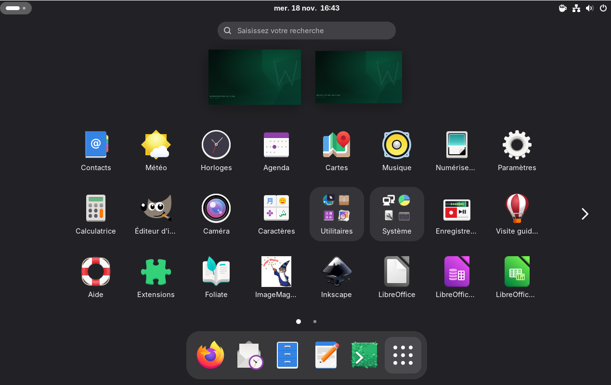

# Workstation Edition

[](https://github.com/benmoussa-younes/workstation/releases/tag/v0.4.2)
[](LICENSE)
[](https://github.com/benmoussa-younes/workstation/actions/workflows/ci.yml)

Ansible roles that turn a **Debian amd64** machine into a GNOME desktop on
Wayland — the session, the link, the identity, the boot splash and the declared
applications — shipped as the collection `benmoussa.workstation`.


`Workstation Edition` is the desktop counterpart of `benmoussa.server`. The
product owns the desktop machine; it does **not** create the human account: the
installer or the site creates it, and the product adds its desktop groups and its
locale. GNOME on Wayland is the only desktop it ships.

## What it does

- **A GNOME desktop on Wayland**, from Debian's own packages: the shell, GDM,
  PipeWire, the fonts and the declared applications. One desktop, no edition to
  choose.
- **One owner for the link**: NetworkManager carries the wired or Wi-Fi link,
  with a static address you declare, a resolver that always has an upstream, and
  a Wi-Fi key stored derived from the passphrase, never in clear.
- **An identity and a boot experience**: the product's name in os-release and on
  the login banner, the emerald wallpaper, GDM's logo, the GRUB menu and a
  Plymouth theme that also asks for the LUKS passphrase.
- **A declared application set**: Ptyxis, Firefox from Mozilla, LibreOffice,
  Evolution, GIMP, Inkscape, Secrets, GNOME Music, VLC as the default media
  handler, Foliate and GNOME Logs — plus six folders in the application grid.
- **No tray, no extension, by decision**: GNOME Shell 48 has no
  StatusNotifier/AppIndicator host of its own, so the product ships no extension,
  no extension switcher and no Tweaks; apt pins the switcher and Tweaks
  uninstallable. An application must work without a tray: closing it quits.
- **Developer tools on demand**: the `scripts` interpreter from its public
  release, the .NET 10 SDK, VSCodium and the rest through `developer_tools`;
  OpenCode when `coding_agents_opencode_enabled` is set, pinned by version and
  checksum.
- **A security baseline**: nftables input default-deny with SSH restricted to
  your sources, a hardened sshd and SSH client, a password policy, kernel and
  audit hardening. Avahi runs only for the mDNS printer discovery; the location
  service's GPS-over-mDNS source stays off. Unprivileged user namespaces stay
  enabled so GNOME's default applications work (Loupe's glycin loaders,
  Flatpak-based applications); a site closes them with
  `hardening_unprivileged_userns_clone: 0`, except `gaming_enabled: true`, which
  keeps them at 1 for Steam.
- **No hibernation by default**: a hibernation image is the whole memory written
  to swap, and the product does not encrypt the swap. `power` masks the
  hibernation, hybrid-sleep and suspend-then-hibernate targets and proves logind
  refuses the verb; a site that accepts the risk sets `power_hibernation:
  enabled` with `power_resume_device` and declares `resume=` in
  `hardening_kernel_cmdline`.
- **Provable by construction**: every role reads its own change back, a second
  converge must print `changed=0`, and a declared address is proved by the boot
  that uses it.

## Screenshots

| The application grid | The system panel |
|---|---|
|  |  |
| **The workspace switcher** | **A GNOME desktop, not a skin** |
|  |  |

## Requirements

- a target running **Debian amd64**. The identity role maps Debian's major
  release to its codename and refuses an unknown one;
- `ansible-core` **2.19 or later** on the controller, with SSH access to the
  target;
- an existing human account, named by `workstation_user`;
- a privilege-escalation password the controller can use
  (`--ask-become-pass`); no account created by the product holds `NOPASSWD`;
- the target's host key in the controller's `known_hosts`;
- network access to `packages.mozilla.org`; `packages.microsoft.com` when
  `developer_tools` selects `dotnet`; `download.vscodium.com` when it selects
  `vscodium`; `github.com` and `api.github.com` when it selects `scripts` and
  when `coding_agents_opencode_enabled` is true; `opencode.ai` only for that
  opt-in installer.

Only `ansible.builtin` is used. `requirements.yml` declares no external
collection.

## Install the collection

From the release tarball:

```sh
ansible-galaxy collection install benmoussa-workstation-0.4.2.tar.gz -p ./collections
```

The release also carries `workstation-0.4.2-src.tar.gz` (the source tree with the
example inventory and the repository tooling) and `SHA256SUMS`:

```sh
sha256sum -c SHA256SUMS
```

The collection carries the roles, the playbooks, `meta/`, `assets/` and the
licence texts. It carries no inventory: the site owns its inventory and its
vault. The source archive carries `inventories/example/`, which documents the
site-facing variables with TEST-NET-1 values only.

## Usage

Create the site inventory from the source archive's `inventories/example/`, or
write a minimal one:

```yaml
all:
  hosts:
    workstation:
      ansible_host: 192.0.2.10
      ansible_user: operator
      ansible_connection: ssh
      workstation_user: operator
  vars:
    identity_product: workstation-gnome
    workstation_desktop_groups: [audio, video, render, input, netdev, bluetooth, cdrom, plugdev, systemd-journal]
    workstation_locale: fr_FR.UTF-8
    workstation_locale_language: fr_FR:fr
    developer_tools: [build, debug, clang, dotnet, lint, ansible, python, shell]
    gaming_enabled: false
    keyboard_layout: fr
    time_timezone: Etc/UTC
    security_ssh_sources: [192.0.2.0/24]
```

A site playbook imports the collection:

```yaml
- import_playbook: benmoussa.workstation.site
```

Or address the collection playbook directly:

```sh
ansible-playbook -i inventories/acme/hosts.yml benmoussa.workstation.site \
  --check --diff --ask-become-pass
ansible-playbook -i inventories/acme/hosts.yml benmoussa.workstation.site \
  --ask-become-pass
# A second real converge must print changed=0.
ansible-playbook -i inventories/acme/hosts.yml benmoussa.workstation.site \
  --ask-become-pass
```

The first converge restarts GDM; run it over SSH, never from the session it may
restart, and keep the console within reach. A change that touches GDM, GRUB or
Plymouth is not proved by `--check`: the visual proof is a console check.

## The roles

| Role | Concern |
|---|---|
| `common` | The Debian package baseline, the periodic security upgrades, the shared directories, the retired packages and the Avahi service. |
| `identity` | The product name on os-release, issue, issue.net and the login banner. |
| `journald` | The journal's size and retention. |
| `keyboard` | The console keyboard and GRUB's copy. |
| `hardening` | The kernel and system policy, `graphical.target`, `splash`, the reboot policy and unprivileged user namespaces. |
| `performance` | The declared VM, I/O and TCP tuning, THP, the CPU governor and the D-Bus provider. |
| `power` | Hibernation, hybrid sleep and suspend-then-hibernate disabled by default, with their read-backs. |
| `network` | NetworkManager owns the link; a site-managed Wi-Fi profile is verified, never overwritten. |
| `resolver` | The stub resolver, fed by the link or by a declared filtering resolver. |
| `time` | Exactly one time daemon and the declared zone. |
| `gnome` | Debian's `gnome-core` and desktop task, and a Wayland session. |
| `desktop` | The account's desktop groups (including CUPS's `lpadmin`), locale and Bluetooth daemon. |
| `dconf` | The GNOME policy as data: appearance, screen lock, privacy, an empty and locked extension set, favorites, the grid folders and the screen blank delay. |
| `applications` | The declared applications, Mozilla Firefox's pinned repository and VLC as the default media handler. |
| `developer` | The `developer_tools` groups, the .NET 10 SDK, the opt-in VSCodium and the Scripts interpreter. |
| `coding_agents` | Opt-in OpenCode, pinned by version and SHA-256; no model, provider or credential. |
| `gaming` | The opt-in Steam stack: Steam, controller rules, `gamemode`, `mangohud` and the 32-bit mesa/vulkan stack. |
| `fonts` | The declared families, Noto Extra/CJK and the fontconfig proof. |
| `audio` | The PipeWire package set; the session proof is after login. |
| `printing` | CUPS, the virtual PDF queue and the network printer discovery. |
| `display` | GDM, `WaylandEnable`, the greeter's logo and the seat read back. |
| `plymouth` | The boot splash, compiled into the initramfs and read back. |
| `branding` | The wallpaper, GDM's logo and GRUB's image, from the product's own assets. |
| `security` | The nftables input policy (IPv4 and IPv6 sources), sshd, the SSH client drop-in and the password policy. |

`roles/README.md` is the catalog: each role's full contract and its status.

## Your own branding

The product ships an emerald visual set under the AGPL: a wallpaper, a GDM mark
and a GRUB image. The Plymouth theme is separate and `GPL-2.0-or-later`. The
displayed name is `Workstation Edition`; a site overrides `identity_name`. A fork
or a site that wants its own marks does not patch a role: every visual is a
variable.

| What | Variable |
|---|---|
| The displayed OS name | `identity_name` (or `identity_names[identity_product]`) |
| The wallpaper | `branding_wallpaper_source` |
| GDM's logo | `branding_logo_source` |
| The GRUB menu's image | `branding_grub_image_source` |
| The boot splash | `plymouth_theme_name`, `plymouth_theme_source`, `plymouth_theme_dir` |

The installed paths are variables too (`branding_wallpaper`, `branding_gdm_logo`,
`branding_grub_image`), and the roles that consume them read them: `dconf`
selects the wallpaper, `display` points the greeter at the logo and `hardening`
owns `/etc/default/grub`.

Declare them in the site's inventory, never in the roles:

```yaml
identity_name: ACME Workstation
branding_wallpaper_source: "{{ playbook_dir }}/../files/acme-wallpaper.png"
branding_logo_source: "{{ playbook_dir }}/../files/acme-logo-64.png"
branding_grub_image_source: "{{ playbook_dir }}/../files/acme-grub.png"
plymouth_theme_name: acme
plymouth_theme_source: "{{ playbook_dir }}/../files/theme/acme"
plymouth_theme_dir: /usr/share/plymouth/themes/acme
```

A theme is a directory named like its manifest, and the manifest names the script
and the image directory by their installed paths. Copy the product's theme as
the skeleton and keep the `ImageDir`, `ScriptFile` and `ImageFile` lines of the
`[script]` section consistent with `plymouth_theme_dir`:

```sh
cp -r assets/branding/theme/workstation files/theme/acme
cd files/theme/acme
mv workstation.plymouth acme.plymouth
mv workstation.script acme.script
sed -i 's|/usr/share/plymouth/themes/workstation|/usr/share/plymouth/themes/acme|g; s|workstation.script|acme.script|g' acme.plymouth
```

The images the script loads are yours. The Workstation script derives from
Debian's `softwaves`; the emerald images are new work, and the whole theme is
`GPL-2.0-or-later`, so a fork that starts from it keeps that licence.

## Verify a run

- `--check --diff` is a forecast, not proof.
- A real converge is proved by a second real converge at `changed=0`.
- A declared address is proved by the boot that uses it: with
  `network_boot_address` declared and `workstation_reboot_after: true`, the
  playbook reboots when it is handing the link over, reconnects at the declared
  address and fails if the link comes back on a DHCP lease. Without the
  variable, nothing reboots.
- The visual proof is a console check: the GDM screen, the wallpaper, the boot
  splash and the boot menu are not proved by `--check`.
- After login, the session proof covers the Wayland session, NetworkManager,
  PipeWire, the dconf values, the fonts and the declared applications.

## Project status

Maintained by one author; the current release is `0.4.2` (Debian amd64, GNOME 48
on Wayland). Known limits:

- GNOME's About panel reports "Disk capacity: unknown" on an NVMe host whose
  `UDisksDrive` size is 0 while the block device carries it; `lsblk` and `df -h`
  show the truth (upstream GNOME/udisks).
- `power_hibernation: enabled` is implemented and reviewed, but its only proof
  is a real hibernate and resume at the console; the default `disabled` is
  proved on the laptop.
- The end-of-play assertions (user namespaces, the Avahi/mDNS pair) are not
  tagged: a `--tags` converge skips them.

## Migration from 0.2.x

`0.3.0` removed the optional `virtualization` role (libvirt, virt-manager and
rootless Podman). A site that set `virtualization_enabled: true` declares the
stack with the `virtualization` and `container` products instead; the workstation
keeps the firewall, SSH, account and desktop policy. The `virbr*` and
`libvirt_nat` rules, the `virt-manager` favorite and `qemu-guest-agent` were
removed with the role.

## Support and contributing

Issues and discussions are disabled on this repository. A change is made as a
pull request, against a board the maintainer keeps outside the repository.
External contributions are not accepted at this time; unsolicited pull requests
and patches may be closed without review. This policy does not limit the rights
the licences grant you.

A security report is private: follow
[`SECURITY.md`](https://github.com/benmoussa-younes/workstation/blob/main/SECURITY.md),
never a public issue. The contribution terms are in
[`CONTRIBUTING.md`](https://github.com/benmoussa-younes/workstation/blob/main/CONTRIBUTING.md).
No support, service level or warranty is provided beyond the licences. A fork is
welcome and is yours to maintain. The gate and the release process are described
in
[`AGENTS.md`](https://github.com/benmoussa-younes/workstation/blob/main/AGENTS.md).

## Licence

The product code is `AGPL-3.0-or-later`; the documentation is `CC-BY-SA-4.0`;
the Plymouth theme is `GPL-2.0-or-later` and is never relicensed. `LICENSE` is
the AGPL text, `LICENSES/` holds every licence text, `NOTICE` states the layers
and `REUSE.toml` maps every path. `reuse lint` proves the map.
